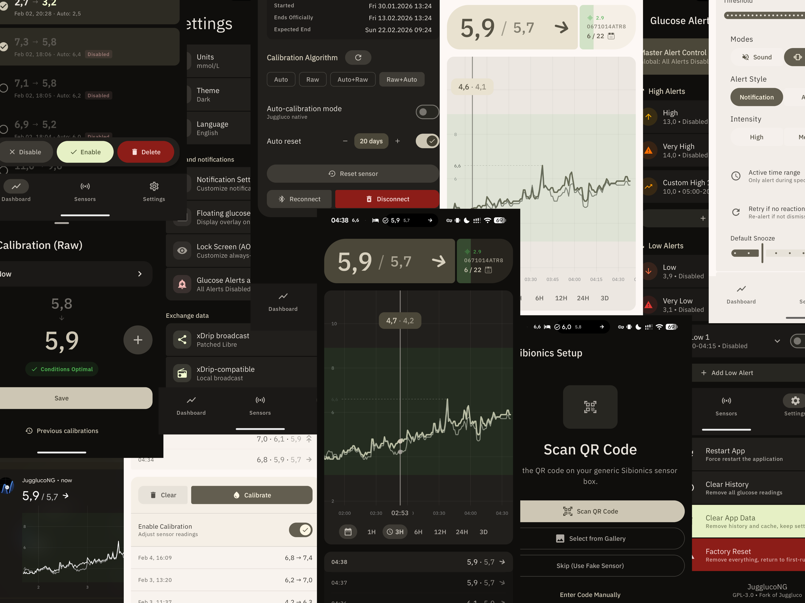

# JugglucoNG — Personal Libre 2 Fork

An experimental continuous glucose monitoring app for Android, based on [JugglucoNG](https://github.com/ctqvva/JugglucoNG).

**This repository is an independent personal fork of JugglucoNG.** It is not the official upstream project, and it is not an official release maintained or endorsed by the upstream maintainers. The upstream application is the foundation of this fork; most general app functionality, supported sensor integrations, and the user interface originate in JugglucoNG.

The main purpose of this fork is to carry personal changes, with a particular focus on **FreeStyle Libre 2 Bluetooth connection reliability, recovery, and diagnostics**.



<sub>English · Беларуская · 中文 · Deutsch · Français · Italiano · Nederlands · Polski · Português · Русский · Svenska · Soomaali · Türkçe · Українська · Монгол</sub>

> [!WARNING]
> **Experimental software — not a medical device.**
>
> JugglucoNG and this personal fork may contain bugs and may display incorrect, delayed, or missing data. Do not rely on either as the sole basis for treatment, insulin dosing, diagnosis, or other medical decisions. Always verify clinically significant readings using the manufacturer's official system or another appropriate method.

## What is specific to this fork?

The custom work in this repository is focused mainly on the Libre 2 Bluetooth connection lifecycle. In addition to the reconnect handling already present in upstream JugglucoNG, this fork includes:

- **A connected-stream watchdog.** It checks for complete Libre 2 data packets, rather than treating a Bluetooth connection or RSSI updates alone as proof that glucose data is still arriving.
- **Automatic recovery from a stalled stream.** On the phone build, if no complete packet arrives for 120 seconds, the app can close the current GATT connection, reset the native Bluetooth stream, wait for a short cooldown, and make a fresh connection attempt.
- **Recovery safeguards.** Recovery is bounded and is cancelled or skipped when the sensor is paused, is not locally owned, or is being handled through the clone/other-device path. A short, time-limited wake lock is used while scheduled recovery is in progress.
- **More detailed Libre 2 diagnostics.** Optional `LIBRE2_DIAG` log entries record connection attempts, handshake stages, packet reception, disconnects, recovery timing, and reset activity. These logs are intended to make intermittent Bluetooth problems easier to investigate.
- **A reconnection regression test.** `tools/test-libre2-connect.py` exercises the production connection and recovery logic against a deterministic simulated BLE environment.

These changes are intended to improve recovery from a connection that appears active but has stopped delivering complete glucose packets. They do not guarantee uninterrupted readings and have not been validated on every phone, Android version, or Libre 2 sensor. The regression test is a code-level simulation, not a substitute for testing with a physical sensor.

The Libre 2 NFC reading and Abbott data-processing implementation remains based on the upstream code. The main Libre 2-specific work in this fork is around Bluetooth connection management, recovery, and diagnostics rather than a new sensor protocol implementation.

## Sensor and data-source support

The sensor and data-source integrations below are inherited from JugglucoNG. Actual availability can depend on the phone, sensor generation, region, firmware, and the state of upstream or fork-specific code.

- Abbott FreeStyle Libre / 2 / 2+ / 3 / 3+
- Dexcom G7 / ONE+
- CareSens Air
- Accu-Chek SmartGuide
- Sibionics GS1 (EU, Chinese, and Hematonix), Sibionics 2
- AiDex X / LinX
- iCan i3 / i6 (Sinocare)
- Anytime / Yuwell
- MQ / Glutec
- Ottai / SyAi

Follower sources: Nightscout and the HTTP API.

Multiple direct sensors can run at the same time. An opt-in handover mode starts the next sensor automatically when the current one reaches its official expiry. Bluetooth fingerstick meters can log readings straight into the journal.

Support for individual sensors is community-developed and may change or stop working as manufacturers update firmware, protocols, or online services.

## Core application features

The following describes the broader JugglucoNG application inherited by this fork; it is not a claim that every feature was developed in this repository.

**Glucose display.** Material 3 dashboard with trend arrow, delta, and reading history; statistics (time in range, GMI, AGP percentile views, exportable reports) with persistent time ranges; charts in the notification shade; always-on display; floating overlay; home-screen widgets; automatic dark mode.

**Alarms.** Custom alarm engine: low/high with time ranges and episodes, rate-of-change alarms (falling/rising fast), sensor-expiry warnings at configurable thresholds, signal-loss and forecast alerts, follower alerts. Alarms can be spoken (TTS), delayed, or vibrate-first, and a failed delivery does not silently consume the alarm.

**Journal and insulin.** Food database with meal curves, dose calculator, insulin-on-board (IOB/eIOB) and carbs-on-board (COB) tracking, treatment intake from AAPS, treatment sync with Nightscout, quick-add entries.

**Prediction.** On-device predictive simulation of glucose, insulin, and meals, with configurable model profiles.

**Nightscout.** Upload readings and treatments, follow a remote site, and exchange IOB/eIOB/COB through `devicestatus` in both roles (opt-in). Long-acting insulin entries are supported.

**Data.** Sensor-independent local database with export/import, direct import of Juggluco's TSV export, settings export, and non-destructive calibration exports. Per-sensor calibration models with chart and table views.

**Sharing and integrations.** [Clone the app to another phone](docs/clone.md) over LAN or the internet (ICE/TURN, no account needed); `glucodata`-style broadcasts for other apps and watchfaces; Health Connect; Pebble; an [outbound API](docs/outbound-api.md) that pushes readings to chatbots, emergency SMS, or any webhook.

## Building

Requirements: JDK 21, Android SDK with NDK and CMake, and the libjuice submodule:

```sh
git submodule update --init

./gradlew :Common:assembleMobileDebug --no-daemon
./gradlew :Common:assembleMobileRelease --no-daemon
```

The app is localized into 15 languages; new user-facing strings go into `Common/src/main/res/values/strings.xml` and every `values-*` locale.

Build helpers live in [scripts/](scripts/README.md), developer tools in `tools/`, and documentation images in `docs/assets/`. Historical root files are preserved in [tools/archive/root-cleanup/](tools/archive/root-cleanup/README.md).

## License and credits

GPL-3.0 (see [LICENSE.txt](LICENSE.txt)). This repository is a derivative work based on [JugglucoNG](https://github.com/ctqvva/JugglucoNG), developed by ctqvva with contributions from the community. JugglucoNG itself originated as a fork of [Juggluco](https://github.com/j-kaltes/Juggluco) by Jaap Korthals Altes. The original projects, authors, and contributors retain their respective credits and copyrights.

The Libre 2 changes in this repository are independent modifications maintained in this personal fork. They are not presented as official JugglucoNG features and are not endorsed by the upstream maintainers.

**Disclaimer:** This software is provided **"as is"**, without warranty of any kind, to the fullest extent permitted by applicable law. JugglucoNG and this personal fork are experimental software and are **not medical devices**. The authors and contributors make no guarantees regarding accuracy, reliability, availability, or fitness for any particular purpose. Always verify clinically significant readings using the manufacturer's official system or another appropriate method before making treatment decisions.
