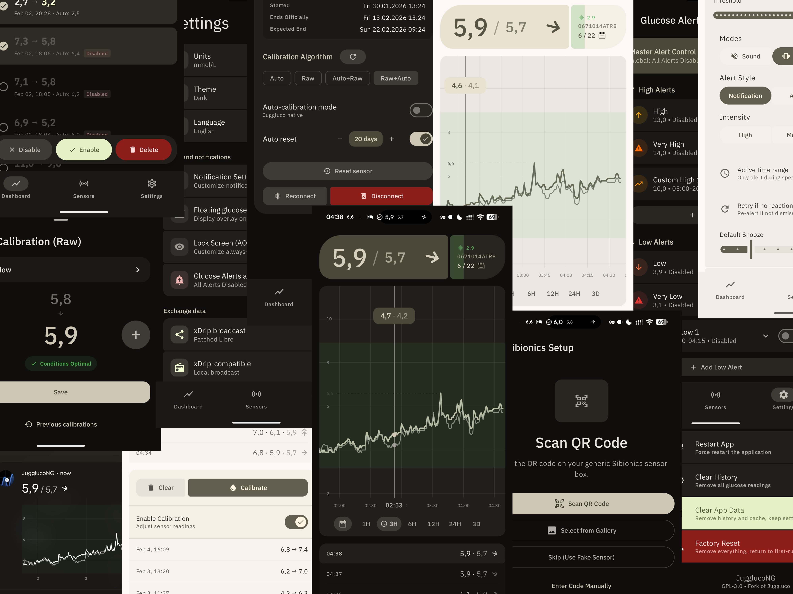

# JugglucoNG — personal fork

This is an independent personal fork of [JugglucoNG](https://github.com/ctqvva/JugglucoNG), an experimental continuous glucose monitoring app for Android.

The `main5` branch builds on upstream **1.2.8-Alpha** and focuses on Libre 2 connectivity, phone and Wear OS customization, and reporting.

See the [integration audit](docs/integration-main5.md) for the original port and the [fork releases](https://github.com/VViktorr/JugglucoNG-personal/releases) for APK downloads.

Originally forked from [Juggluco](https://github.com/j-kaltes/Juggluco) by Jaap Korthals Altes, it continues to evolve with a modern Compose UI using Material 3, a sensor-independent data layer, support for multiple CGM systems, a treatment journal with IOB/eIOB/COB tracking, predictive simulation, a redesigned alarm engine, and bidirectional Nightscout integration.



<sub>English · Беларуская · 中文 · Deutsch · Français · Italiano · Nederlands · Polski · Português · Русский · Svenska · Soomaali · Türkçe · Українська · Монгол</sub>

> [!WARNING]
> **Experimental software — not a medical device.**
>
> JugglucoNG may contain bugs and may display incorrect, delayed, or missing data. Do not rely on it as the sole basis for treatment, insulin dosing, diagnosis, or other medical decisions. Always verify clinically significant readings using the manufacturer's official system or another appropriate method.

## Changes in this fork

- **Libre 2 and Libre 2 Plus BLE:** a 150-second stream watchdog, bounded GATT recovery escalation on the phone, protection against stale loss alarms and duplicate Android connection callbacks, and improved reconnection when the phone or watch takes over the sensor. The sensor screen reports local GATT connection state.
- **Libre 2 NFC and diagnostics:** raw one-minute NFC trend samples are stored separately for supported Libre 2 sensors, so an NFC scan cannot advance the live BLE duplicate cursor on that path. Diagnostic traces cover the BLE connection lifecycle, first readings and the official and calendar expiry times.
- **LibreView:** Libre 2 region and unit selection, reauthentication, registration retry and timeout handling.
- **Home-screen widgets:** configurable classic, chart, range and clock/weather layouts, resizing, font and background options, and charts that can span sensor handovers. Refresh handling clears stale values.
- **Dashboard and charts:** stacked information bars, adjustable bar proportions, sensor end time and clearer stale-reading status. Chart changes include custom scale limits, more readable axis and target labels, and consistent range controls.
- **Appearance and settings:** organized settings categories, localized search, and a phone-wide choice of IBM Plex Sans or system typography for themed screens. Widgets retain their own font selection.
- **Phone notifications and overlays:** configurable glucose presentation through Live Update and MetricStyle where supported, plus refinements to the floating glucose and always-on display.
- **Wear OS:** choose a standard icon, glucose value, trend arrow, or value and arrow together. The choice can be synced from **Sensors and devices → Watch → Wear OS → Configuration → Actions**. Fresh installs default to the glucose value. The watch requests notification permission when its window is ready and prioritizes refreshing the notification panel.
- **Reports and journal:** expanded clinical PDF reports with AGP percentiles, calendar ranges, meal profiles and injection annotations, plus Health Connect activity import for the journal.
- **APK distribution:** numbered `1.2.8.N` releases bundle separate phone and Wear OS APKs. Each APK includes both ARM32 and ARM64.

## Builds

Download both APKs from [Releases](https://github.com/VViktorr/JugglucoNG-personal/releases), or select `main5` in the [manual build workflow](https://github.com/VViktorr/JugglucoNG-personal/actions/workflows/personal-apk.yml).

## Sensor and data-source support

- Abbott FreeStyle Libre / 2 / 2+ / 3 / 3+
- Dexcom G7 / ONE+
- CareSens Air
- Accu-Chek SmartGuide

- Sibionics GS1 (EU, Chinese, and Hematonix), Sibionics 2
- AiDex X / LinX
- iCan i3 / i6 (Sinocare)
- Anytime / Yuwell
- MQ / Glutec
- Ottai / SyAi

Follower sources: Nightscout and the HTTP API.

Multiple direct sensors can run at the same time. An opt-in handover mode starts the next sensor automatically when the current one reaches its official expiry. Bluetooth fingerstick meters can log readings straight into the journal.

Support for individual sensors is community-developed and may change or stop working as manufacturers update firmware, protocols, or online services.

## Features

**Glucose display.** Material 3 dashboard with trend arrow, delta, and reading history; statistics (time in range, GMI, AGP percentile views, exportable reports) with persistent time ranges; charts in the notification shade; always-on display; floating overlay; home-screen widgets; automatic dark mode.

**Alarms.** Custom alarm engine: low/high with time ranges and episodes, rate-of-change alarms (falling/rising fast), sensor-expiry warnings at configurable thresholds, signal-loss and forecast alerts, follower alerts. Alarms can be spoken (TTS), delayed, or vibrate-first, and a failed delivery does not silently consume the alarm.

**Journal and insulin.** Food database with meal curves, dose calculator, insulin-on-board (IOB/eIOB) and carbs-on-board (COB) tracking, treatment intake from AAPS, treatment sync with Nightscout, quick-add entries.

**Prediction.** On-device predictive simulation of glucose, insulin, and meals, with configurable model profiles.

**Nightscout.** Upload readings and treatments, follow a remote site, and exchange IOB/eIOB/COB through `devicestatus` in both roles (opt-in). Long-acting insulin entries are supported.

**Data.** Sensor-independent local database with export/import, direct import of Juggluco's TSV export, settings export, and non-destructive calibration exports. Per-sensor calibration models with chart and table views.

**Sharing and integrations.** [Clone the app to another phone](docs/clone.md) over LAN or the internet (ICE/TURN, no account needed); `glucodata`-style broadcasts for other apps and watchfaces; Health Connect; Pebble; an [outbound API](docs/outbound-api.md) that pushes readings to chatbots, emergency SMS, or any webhook.

## Building

Requirements: JDK 21, Android SDK with NDK and CMake, and the libjuice submodule:

```sh
git submodule update --init

./gradlew :Common:assembleMobileDebug --no-daemon
--
./gradlew :Common:assembleMobileRelease --no-daemon
```

The app is localized into 15 languages; new user-facing strings go into `Common/src/main/res/values/strings.xml` and every `values-*` locale.

Build helpers live in [scripts/](scripts/README.md), developer tools in `tools/`, and documentation images in `docs/assets/`. Historical root files are preserved in [tools/archive/root-cleanup/](tools/archive/root-cleanup/README.md).

## License and credits

GPL-3.0 (see [LICENSE.txt](LICENSE.txt)). Forked from [Juggluco](https://github.com/j-kaltes/Juggluco) by Jaap Korthals Altes. Developed by [ctqvva](https://github.com/ctqvva) with contributions from the community.

**Disclaimer:** This software is provided **"as is"**, without warranty of any kind, to the fullest extent permitted by applicable law. JugglucoNG is experimental software and is **not a medical device**. The authors and contributors make no guarantees regarding its accuracy, reliability, availability, or fitness for any particular purpose. Always verify clinically significant readings using the manufacturer's official system or another appropriate method before making treatment decisions.
