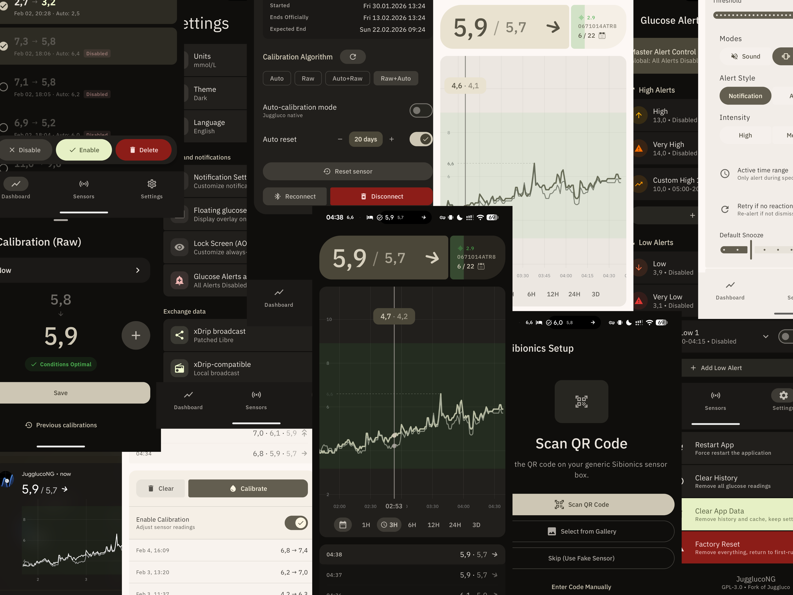

# JugglucoNG — personal fork

This is an independent personal fork of [JugglucoNG](https://github.com/ctqvva/JugglucoNG), an experimental continuous glucose monitoring app for Android. JugglucoNG began as a fork of [Juggluco](https://github.com/j-kaltes/Juggluco) by Jaap Korthals Altes.

The `main` branch combines the newer upstream codebase with personal changes from [`main5`](https://github.com/VViktorr/JugglucoNG-personal/tree/main5). It includes a Material 3 Expressive interface on Android and Wear OS, a sensor-independent data layer, and a treatment journal with IOB/eIOB/COB tracking.



<sub>English · Беларуская · 中文 · Deutsch · Español · Français · Italiano · Nederlands · Polski · Português · Русский · Svenska · Soomaali · Türkçe · Українська · Монгол</sub>

> [!WARNING]
> **Experimental software — not a medical device.**
>
> JugglucoNG may contain bugs and may display incorrect, delayed, or missing data. Do not rely on it as the sole basis for treatment, insulin dosing, diagnosis, or other medical decisions. Always verify clinically significant readings using the manufacturer's official system or another appropriate method.

## Changes in this fork

- **Dashboard and chart.** Reorder glucose and information panels, adjust their widths and proportions, and set the chart’s vertical limits or drag the Y axis to rescale. The active insulin summary sits on the right of the dashboard chart. The floating glucose display has a drag handle after a position reset.
- **Appearance and settings.** Choose the app and widget fonts independently. App typography can sync to Wear OS, and widgets preview and apply font changes separately. Settings search links directly to options such as the chart scale limits and the Wear OS notification icon.
- **Home-screen widgets.** Classic, chart, range, and clock/weather layouts with adjustable sizes, colors, visibility, and font weights. Transfer shared settings to the other widget types in one action. The chart can span sensor handovers.
- **Phone and watch notifications.** Configure the glucose content shown by Android Live Updates where supported. On Wear OS, choose a standard icon, glucose value, trend arrow, or value and arrow together.
- **Reports and journal.** Create [LibreView-style PDF reports](docs/libreview-report-layout.md) with AGP percentiles, calendar summaries, meal profiles, and configurable fonts. The journal refreshes Health Connect activity when opened.
- **Libre 2 and LibreView.** Libre 2 and Libre 2 Plus use the upstream Kotlin Gen2 connection and open Libre 2 processing, with the fork’s additional recovery for streams that stop delivering readings. LibreView supports region and unit selection, reauthentication, and registration retries.

## Download and updates

Use [Releases](https://github.com/VViktorr/JugglucoNG-personal/releases) for APKs from this fork. The [numbered build workflow](https://github.com/VViktorr/JugglucoNG-personal/actions/workflows/personal-apk.yml) publishes `main` builds with tags in the form `main-v<version>`.

| APK filename suffix | Device |
| --- | --- |
| `-phone.apk` | Android phone |
| `-wear.apk` | Wear OS watch |

Both APKs are built for ARM64 and ARM32. Release assets include `SHA256SUMS.txt` and build metadata. Back up your settings and data before switching from `main5` or an upstream build. Android requires the app ID and signing key to match for an in-place update.

## Sensor and data-source support

- Abbott FreeStyle Libre / 2 / 2+ / 3 / 3+
- Dexcom G7 / ONE+
- CareSens Air
- Accu-Chek SmartGuide
- Sibionics GS1 (EU, Chinese, and Hematonix), Sibionics 2
- AiDex X / LinX
- iCan i3 / i6 (Sinocare)
- Anytime / Yuwell
- MQ / Glutec
- Ottai / SyAi

Follower sources: Nightscout and the HTTP API.

Multiple direct sensors can run at the same time. An opt-in handover mode starts the next sensor automatically when the current one reaches its official expiry. Bluetooth fingerstick meters can log readings straight into the journal.

Support for individual sensors is community-developed and may change or stop working as manufacturers update firmware, protocols, or online services.

## Features

**Glucose display.** Material 3 dashboard with trend arrow, delta, and reading history; statistics (time in range, GMI, AGP percentile views, exportable reports) with persistent time ranges; charts in the notification shade; always-on display; floating overlay; home-screen widgets; automatic dark mode.

**Alarms.** Custom alarm engine: low/high with time ranges and episodes, rate-of-change alarms (falling/rising fast), sensor-expiry warnings at configurable thresholds, signal-loss and forecast alerts, follower alerts. Alarms can be spoken (TTS), delayed, or vibrate-first, and a failed delivery does not silently consume the alarm.

**Journal and insulin.** Food database with meal curves, dose calculator, insulin-on-board (IOB/eIOB) and carbs-on-board (COB) tracking, treatment intake from AAPS, treatment sync with Nightscout, quick-add entries.

**Prediction.** On-device predictive simulation of glucose, insulin, and meals, with configurable model profiles.

**Nightscout.** Upload readings and treatments, follow a remote site, and exchange IOB/eIOB/COB through `devicestatus` in both roles (opt-in). Long-acting insulin entries are supported.

**Data.** Sensor-independent local database with export/import, direct import of Juggluco's TSV export, settings export, and non-destructive calibration exports. Per-sensor calibration models with chart and table views.

**Sharing and integrations.** [Clone the app to another phone](docs/clone.md) over LAN or the internet (ICE/TURN, no account needed); `glucodata`-style broadcasts for other apps and watchfaces; Health Connect; Pebble; an [outbound API](docs/outbound-api.md) that pushes readings to chatbots, emergency SMS, or any webhook.

## Building

Use JDK 21, Android SDK Platform 37.2, Build-Tools 37.0.0, NDK r30 (`30.0.16248370`), and CMake 4.1.2. The repository includes the Gradle 9.9.2 wrapper.

| SDK setting | Phone | Wear OS |
| --- | --- | --- |
| Compile SDK | 37.2 | 37.2 |
| Target SDK | 36 | 35 |
| Minimum OS | Android 14 (API 34) | Wear OS 5 (API 34) |

Initialize the libjuice submodule from the repository root before building.

```sh
git submodule update --init --recursive
```

### Windows (PowerShell)

In Android Studio, open **Tools → SDK Manager** to find the **Android SDK Location**. Under **SDK Tools**, install **Android SDK Command-line Tools (latest)**. Set `ANDROID_HOME` to that SDK location. The example uses the default Windows path and [Android CLI](https://developer.android.com/tools/agents/android-cli/commands/sdk_install).

```powershell
$env:ANDROID_HOME = Join-Path $env:LOCALAPPDATA 'Android\Sdk'
$androidCli = Join-Path $env:ANDROID_HOME 'cmdline-tools\latest\bin\android.exe'
if (-not (Test-Path -LiteralPath $androidCli -PathType Leaf)) {
    throw "Check ANDROID_HOME and install Android SDK Command-line Tools (latest)."
}

& $androidCli "--sdk=$env:ANDROID_HOME" sdk install 'platforms/android-37.2' 'platforms/android-36' 'build-tools/37.0.0' 'ndk/30.0.16248370' 'cmake/4.1.2'
if ($LASTEXITCODE -ne 0) { throw "SDK package installation failed." }

.\gradlew.bat :Common:assembleMobileDebug :Common:assembleWearDebug
```

The Android Studio SDK Manager can also install the packages. Under **SDK Platforms**, select Android SDK Platform 37.2 and 36. Under **SDK Tools**, enable **Show Package Details** and select Build-Tools 37.0.0, NDK (Side by side) 30.0.16248370, and CMake 4.1.2.

For a local phone and Wear OS build with a timestamped APK archive, run [`BUILD.ps1`](BUILD.ps1) from the repository root. It requires Python 3.9 or newer to verify the JNI libraries and restore missing files from the baseline pinned in `scripts/dist/build-inputs.json`.

```powershell
.\BUILD.ps1                          # Release APKs
.\BUILD.ps1 -Configuration Debug     # Debug APKs
.\BUILD.ps1 -Clean                   # Clean first, then build Release
```

Archives are stored in `Builds/Build-<timestamp>/` with `SHA256.txt` and `BUILD-INFO.txt`. Release signing follows your Gradle configuration.

Run these commands in the same PowerShell session. To persist the SDK location for this checkout, set `sdk.dir` in the root `local.properties` file, for example `sdk.dir=C:/Users/YourName/AppData/Local/Android/Sdk`. If the file already has an SDK path, make sure it points to the same installation.

### Linux and macOS (Bash)

Set `ANDROID_HOME` to your SDK directory and install Android SDK Command-line Tools (latest).

```sh
bash scripts/dist/install-sdk.sh
./gradlew :Common:assembleMobileDebug :Common:assembleWearDebug
```

See [build scripts](scripts/README.md) and the [numbered build workflow](.github/workflows/personal-apk.yml) for build and release tooling.

## License and credits

The app source is licensed under GPL-3.0. See [LICENSE.txt](LICENSE.txt). Thanks to Jaap Korthals Altes, [ctqvva](https://github.com/ctqvva), and the Juggluco and JugglucoNG contributors.

### Bundled font licenses

| Fonts | License and notices |
| --- | --- |
| IBM Plex Sans, Comfortaa, DM Sans, Inter, Noto Sans, Oswald, Plus Jakarta Sans, Poppins, Roboto Condensed, Roboto Flex, Rubik | SIL Open Font License 1.1. [Individual licenses and copyright notices](Common/src/main/assets/font_licenses/) |
| Ubuntu | [Ubuntu Font Licence 1.0](Common/src/main/assets/font_licenses/ubuntu.txt) |
| HarmonyOS Sans | [Huawei HarmonyOS Sans Fonts License Agreement](Common/src/main/assets/font_licenses/harmonyos.txt) and [copyright notice](Common/src/main/assets/font_licenses/NOTICE.txt) |
| PDF report fonts | SIL Open Font License 1.1. [Inter](Common/src/mobile/assets/report_fonts/Inter-OFL.txt) and [Liberation Sans](Common/src/mobile/assets/report_fonts/Liberation-OFL.txt) |
| Open Sans used in mobile resources | [SIL Open Font License 1.1](Common/src/mobile/assets/font_licenses/opensans.txt) |
| Carlito subset in the native renderer | [SIL Open Font License 1.1](Common/src/main/assets/font_licenses/carlito.txt) |

The selectable fonts’ licenses are available under **About → Font licences** on the phone and in the watch settings. For font sources and checksums, see the [font catalog documentation](docs/fonts/README.md).

**Disclaimer:** This software is provided **"as is"**, without warranty of any kind, to the fullest extent permitted by applicable law. JugglucoNG is experimental software and is **not a medical device**. The authors and contributors make no guarantees regarding its accuracy, reliability, availability, or fitness for any particular purpose. Always verify clinically significant readings using the manufacturer's official system or another appropriate method before making treatment decisions.
